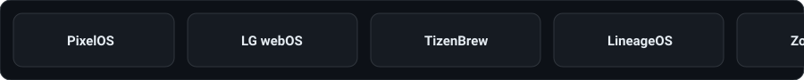

[README.md](https://github.com/user-attachments/files/34287716/README.md)

### KCHECKSFILES

*Ideas → Experiments → Projects.*

---

### A little about this place

I'm someone with a lot of ideas and an even bigger curiosity about whether I can actually make them work.

I don't come from a traditional coding background. I use AI as a tool to explore ideas, build things I otherwise might not have been able to, and figure out problems along the way.

Sometimes it starts with a random thought. Sometimes it's a problem I want to solve. Sometimes I just want to see if something is possible.

I experiment, build, break things, debug, learn and repeat.

**This isn't a portfolio. It's where my curiosity goes to work.**

---

### Experiments & projects

A few things that started as ideas and turned into actual projects.

<table>
  <tr>
    <td align="center" width="33%">
      <a href="https://github.com/kchecksfiles/CineTube">
        
         <strong>CineTube</strong>
      </a>
    </td>
    <td align="center" width="33%">
      <a href="https://github.com/kchecksfiles/ShredPack">
        
         <strong>ShredPack</strong>
      </a>
    </td>
    <td align="center" width="33%">
      <a href="https://github.com/kchecksfiles/Lenovo-Fan-Control">
        
         <strong>Lenovo Fan Control</strong>
      </a>
    </td>
  </tr>
</table>

---

### Things I've tinkered with

A collection of things I've used, explored, modified, learned from or experimented with.

<marquee behavior="scroll" direction="left" scrollamount="5" onmouseover="this.stop();" onmouseout="this.start();">
  <a href="https://pixelos.net" target="_blank" style="margin-right: 50px; text-decoration: none; color: #c9d1d9; font-family: -apple-system, BlinkMacSystemFont, sans-serif; font-weight: 600; font-size: 16px;">
     PixelOS
  </a>
  <a href="https://webosbrew.org" target="_blank" style="margin-right: 50px; text-decoration: none; color: #c9d1d9; font-family: -apple-system, BlinkMacSystemFont, sans-serif; font-weight: 600; font-size: 16px;">
     LG webOS Homebrew
  </a>
  <a href="https://github.com" target="_blank" style="margin-right: 50px; text-decoration: none; color: #c9d1d9; font-family: -apple-system, BlinkMacSystemFont, sans-serif; font-weight: 600; font-size: 16px;">
     TizenBrew
  </a>
  <a href="https://lineageos.org" target="_blank" style="margin-right: 50px; text-decoration: none; color: #c9d1d9; font-family: -apple-system, BlinkMacSystemFont, sans-serif; font-weight: 600; font-size: 16px;">
     LineageOS
  </a>
  <a href="https://zorin.com" target="_blank" style="margin-right: 50px; text-decoration: none; color: #c9d1d9; font-family: -apple-system, BlinkMacSystemFont, sans-serif; font-weight: 600; font-size: 16px;">
     Zorin OS
  </a>
  <a href="https://github.com" target="_blank" style="margin-right: 50px; text-decoration: none; color: #c9d1d9; font-family: -apple-system, BlinkMacSystemFont, sans-serif; font-weight: 600; font-size: 16px;">
     ShredPack
  </a>
  <a href="https://github.com" target="_blank" style="margin-right: 50px; text-decoration: none; color: #c9d1d9; font-family: -apple-system, BlinkMacSystemFont, sans-serif; font-weight: 600; font-size: 16px;">
     Lenovo Fan Control
  </a>
  <a href="https://pcstudio.in" target="_blank" style="margin-right: 50px; text-decoration: none; color: #c9d1d9; font-family: -apple-system, BlinkMacSystemFont, sans-serif; font-weight: 600; font-size: 16px;">
     PC Building
  </a>
  <a href="https://chrome.com" target="_blank" style="margin-right: 50px; text-decoration: none; color: #c9d1d9; font-family: -apple-system, BlinkMacSystemFont, sans-serif; font-weight: 600; font-size: 16px;">
     Chrome Extensions
  </a>
  <a href="https://github.com" target="_blank" style="margin-right: 50px; text-decoration: none; color: #c9d1d9; font-family: -apple-system, BlinkMacSystemFont, sans-serif; font-weight: 600; font-size: 16px;">
     Debloating
  </a>
</marquee>

---

**Curiosity is the brief. Building is the game.**

Still figuring things out. Probably building something right now.

