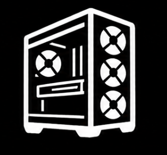

### Things I've tinkered with

A collection of things I've used, explored, modified, learned from or experimented with.

<table border="0" style="border-collapse: collapse;">
  <tr>
    <td align="center" width="18%" style="border: none;">
       
      <a href="https://pixelos.net/" target="_blank">PixelOS</a>
    </td>
    <td align="center" width="18%" style="border: none;">
       
      <a href="https://www.webosbrew.org/" target="_blank">LG webOS</a>
    </td>
    <td align="center" width="18%" style="border: none;">
       
      <a href="https://github.com/reisxd/TizenBrew" target="_blank">TizenBrew</a>
    </td>
    <td align="center" width="18%" style="border: none;">
       
      <a href="https://lineageos.org/" target="_blank">LineageOS</a>
    </td>
    <td align="center" width="18%" style="border: none;">
       
      <a href="https://zorin.com/os/" target="_blank">Zorin OS</a>
    </td>
  </tr>
  <tr>
    <td align="center" width="18%" style="border: none;">
       
      <a href="https://github.com/kchecksfiles/ShredPack" target="_blank">ShredPack</a>
    </td>
    <td align="center" width="18%" style="border: none;">
       
      <a href="https://github.com/kchecksfiles/Lenovo-Fan-Control" target="_blank">Fan Control</a>
    </td>
    <td align="center" width="18%" style="border: none;">
       
      <a href="https://www.pcstudio.in/pc-build/" target="_blank">PC Building</a>
    </td>
    <td align="center" width="18%" style="border: none;">
       
      <a href="https://developer.chrome.com/docs/extensions/" target="_blank">Extensions</a>
    </td>
    <td align="center" width="18%" style="border: none;">
       
      <a href="https://github.com/ChrisTitusTech/winutil" target="_blank">Debloating</a>
    </td>
  </tr>
</table>

