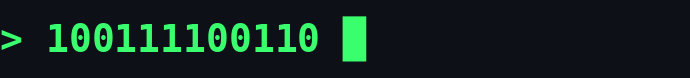
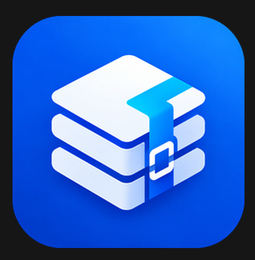
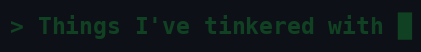

[README.md](https://github.com/user-attachments/files/34312299/README.md)

*Ideas → Experiments → Projects.*

---

I'm someone with a lot of ideas and an even bigger curiosity about whether I can actually make them work.

I don't come from a traditional coding background. I use AI as a tool to explore ideas, build things I otherwise might not have been able to, and figure out problems along the way.

Sometimes it starts with a random thought. Sometimes it's a problem I want to solve. Sometimes I just want to see if something is possible.

I experiment, build, break things, debug, learn and repeat.

**This isn't a portfolio. It's where my curiosity goes to work.**

---

A few things that started as ideas and turned into actual projects.

<table>
  <tr>
    <td align="center" width="33%">
      <a href="https://github.com/kchecksfiles/CineTube">
        
         <strong>CineTube</strong>
      </a>
    </td>
    <td align="center" width="33%">
      <a href="https://github.com/kchecksfiles/ShredPack">
        
         <strong>ShredPack</strong>
      </a>
    </td>
    <td align="center" width="33%">
      <a href="https://github.com/kchecksfiles/Lenovo-Fan-Control">
        
         <strong>Lenovo Fan Control</strong>
      </a>
    </td>
  </tr>
</table>

---

A collection of things I've used, explored, modified, learned from or experimented with.

[**Open the interactive tech playground →**](https://kchecksfiles.github.io/kchecksfiles/playground/)

All ten logos scroll continuously. Hover to pause; click a logo to visit its site.

<table>
  <tr>
    <td align="center"></td>
    <td align="center"></td>
    <td align="center"></td>
    <td align="center"></td>
    <td align="center"></td>
  </tr>
  <tr>
    <td align="center"></td>
    <td align="center"></td>
    <td align="center"></td>
    <td align="center"></td>
    <td align="center"></td>
  </tr>
</table>

---

**Curiosity is the brief. Building is the game.**

Still figuring things out. Probably building something right now.

